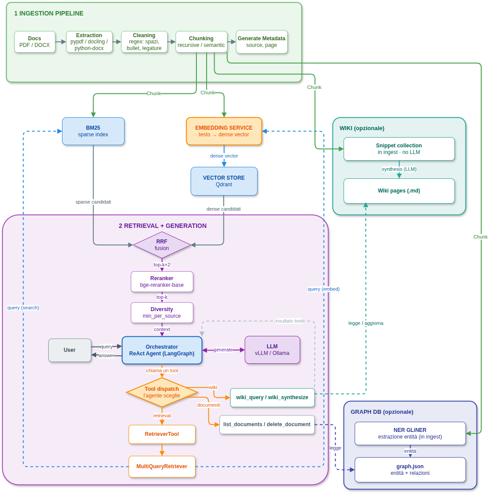

# Vectoria

On-premise RAG (Retrieval-Augmented Generation) for private document Q&A. Runs locally with `uv`, in Docker, or on HPC via Ansible. Works with OpenAI, Anthropic, Google Gemini, Ollama, or any OpenAI-compatible endpoint.

Built for the IT4LIA project. It answers questions over private documents (multi-tenant Q&A) without sending data to third-party cloud services, using CINECA's Leonardo HPC infrastructure for on-premise LLM inference.

## Architecture



## Features

- **Hybrid search** — BM25 + semantic, reranked, with optional MMR for semantic diversity.
- **Knowledge graph** — per-tenant entity graph (GLiNER NER + PMI + spaCy/LLM relations) for relational queries.
- **Per-tenant wiki** — Markdown knowledge base auto-synthesized from your documents.
- **Source citation** — every answer cites `[Source: file]` for each claim.
- **Multi-tenant** — isolated indexes per `X-Tenant-ID`.
- **OpenAI-compatible API** — drop-in for OpenWebUI.
- **ReAct agent** — multi-turn chat with 8 tools and SQLite history.
- **Any LLM backend** — OpenAI, Anthropic, Google Gemini, Ollama via `LLM_PROVIDER`; any OpenAI-compatible endpoint (vLLM, Groq, llama.cpp) via `LLM_BASE_URL`.

## Install

Vectoria uses [`uv`](https://docs.astral.sh/uv/) for Python dependencies.

```bash
uv sync --extra api --no-dev                                       # API only
uv sync --extra api --extra docling --extra observability --no-dev # full stack
```

## Local — Docker

```bash
docker compose up
```

**Config file:** `etc/docker/config.yaml` — edit this to change retriever/reranker/agent settings for local use.

- API: `http://localhost:8000`
- OpenWebUI: `http://localhost:8080`
- Upload UI: `http://localhost:8000/upload`

Optional MLflow on `:5000`:

```bash
docker compose --profile observability up
```

Key `.env` variables:

```bash
DATA_DIR=./data
PERMITTED_KEYS=                # empty = no auth
LLM_PROVIDER=custom            # custom | openai | anthropic | google | ollama
LLM_MODEL=                     # e.g. llama-3.3-70b-versatile, gpt-4o, qwen3.5:32b
# LLM_PROVIDER=custom also needs: LLM_BASE_URL, LLM_API_KEY
# any other provider needs its own *_API_KEY (see .env.example)
```

On first run Docker automatically creates `data/index` and `data/uploads` with the correct ownership via an init container — no manual `chown` needed.

Full template with every variable (HPC/Ansible ones included): [`.env.example`](.env.example). The file `.env` is gitignored.

## HPC — Leonardo / CINECA

**Config file:** `ansible/roles/vectoria/vars/config.yml` — edit this and re-run `ansible-playbook deploy.yml` to change settings on HPC (it renders into `templates/default_config.j2`, which you normally don't need to touch).

### One-command deploy

```bash
# Load secrets first (CINECA account, SSH user, API token, repo URL).
# See .env.example for the full list.
set -a; source .env; set +a    # needed by Ansible; leonardo_connect.sh auto-loads .env

cd ansible/ && ansible-playbook -i inventory deploy.yml
```

Syncs code, pulls the Singularity image, downloads the LLM, submits the SLURM job, and opens SSH tunnels on your PC.

### HPC defaults are "max quality"

The HPC config (`ansible/roles/vectoria/templates/default_config.j2`, rendered by Ansible at deploy time) has everything turned on:

- **MMR** (`mmr_enabled: true`, `lambda=0.7`) for semantic diversity post-rerank
- **Knowledge graph** (PMI filter 0.5, entity resolution, spaCy relations)
- **Wiki** (cross-language dedup, threshold 5)
- **Reranker on CUDA**, BGE-m3 embedder
- **2 nodes** default, pipeline-parallel vLLM via Ray

vLLM runs with `--disable-custom-all-reduce` (fixes NCCL custom kernel errors on Leonardo's InfiniBand without disabling CUDA graphs) and `--gpu-memory-utilization 0.85` to leave headroom for graph capture. Tune `vllm_gpu_memory_utilization` in `ansible/roles/vectoria/vars/config.yml` if you hit OOM.

### Single-node vs multi-node

The job script runs **single-node by default** (`--nodes=1`): vLLM takes GPU 0–1, Vectoria takes GPU 2–3.

To scale to multiple nodes, change `--nodes=N` in the SBATCH header — the script automatically:
- starts a **Ray cluster** across all allocated nodes (head + workers) with correct IB addresses and `VLLM_HOST_IP` per node
- enables `--pipeline-parallel-size N --distributed-executor-backend ray` in vLLM
- waits for the full Ray cluster to be ready before starting vLLM (avoids pipeline stage allocation failures)
- keeps all 4 GPUs on worker nodes available to vLLM; GPU 2–3 on the head node go to Vectoria

Example: `--nodes=2`, `TENSOR_PARALLEL_SIZE=2` → 4 GPUs total for vLLM (2 pipeline stages × 2 tensor-parallel), 2 GPUs for Vectoria.

NCCL InfiniBand is configured automatically (`NCCL_IB_HCA=mlx5`, `NCCL_SOCKET_IFNAME=ib0`). `/dev/shm` is bound into the Singularity container for intra-node GPU shared-memory communication.

Setup, Ansible variables, and troubleshooting: [`ansible/README.md`](ansible/README.md) and [`etc/hpc/README.md`](etc/hpc/README.md).

## Agent Tools

Once Vectoria is running, the ReAct agent has access to these tools:

| Tool | Always on | Purpose |
|---|---|---|
| `retriever` | yes | Hybrid BM25 + semantic search over indexed documents, reranked. |
| `list_documents` | yes | List all files currently indexed for the tenant. |
| `delete_document` | yes | Remove a document by filename from the tenant's index. |
| `wiki_status` | `wiki.enabled` | Show wiki pages and pending concepts queued for synthesis. |
| `wiki_query` | `wiki.enabled` | Search the Markdown wiki by topic. Call before `retriever` for concept questions. |
| `wiki_synthesize` | `wiki.enabled` | Synthesize pending concepts into new wiki pages (uses the LLM). |
| `graph_search` | `graph` extra | Search the knowledge graph for entities related to the query. |
| `graph_neighbors` | `graph` extra | Find entities directly connected to a known entity in the graph. |

## Config

Edit `etc/docker/config.yaml` (local/Docker) or `ansible/roles/vectoria/vars/config.yml` (HPC). Both are endpoint-agnostic — switch provider via `LLM_*`/`LLM_PROVIDER` env vars. HPC-specific tuning is in [`etc/hpc/README.md`](etc/hpc/README.md).

Key knobs:

```yaml
data_ingestion:
  extraction: { backend: auto }        # pypdf (fast, text-only) | docling (GPU, OCR) | auto
  chunking:   { method: recursive }    # recursive (CPU) | semantic (GPU)

vector_store:
  name: chroma                         # chroma | faiss | qdrant
  device: cpu                          # cuda on GPU

retriever:
  search_type: hybrid                  # similarity | mmr | hybrid
  top_k: 12
  multi_query: true
  min_per_source: 2                    # per-source diversity (chunks per file)
  mmr_enabled: false                   # post-rerank semantic diversity
  mmr_lambda: 0.7                      # 1=relevance, 0=diversity
  mmr_top_k: 0                         # 0 = keep all docs

reranker:
  enabled: true
  device: cpu
  model_name: cross-encoder/mmarco-mMiniLMv2-L12-H384-v1  # CPU default (~120 MB, multilingual)

wiki:
  enabled: true
  max_topics_per_doc: 3
  max_topics_per_batch: 8

graph_store:
  enabled: false                       # set true for entity graph + relational queries
  extraction_device: cpu               # cuda on GPU nodes
  min_pmi: 0.5                         # noise filter on edges
  entity_resolution: true              # merge similar entity names
  spacy_model: it_core_news_sm         # free relation labels (alternative to LLM)

inference_engine:
  name: openai                         # openai | anthropic | huggingface | llamacpp
  base_url: http://host.docker.internal:11434/v1
  model_name: qwen2.5:3b
```

Simplest way to switch provider: set `LLM_PROVIDER` in `.env` instead of editing this file (see above).

## Multi-tenancy

```bash
curl -X POST http://localhost:8000/documents/ingest \
  -H "X-Tenant-ID: company-a" \
  -F "file=@document.pdf"
```

OpenAI model name: `vectoria-<tenant_id>`. Indexes at `data/index/<tenant_id>/`.

## Project Structure

```text
vectoria/
├── bin/                  # CLI, interactive chat
├── etc/
│   ├── docker/           # Docker config
│   ├── hpc/              # SLURM + HPC config
│   ├── shared/           # shared CLI + prompts
│   └── custom/           # per-deployment CLI + prompt overrides
├── ansible/              # HPC deployment
├── vectoria_lib/
│   ├── api/              # FastAPI, tenant registry, OpenAI-compat
│   ├── llm/              # ReAct agent, tools, inference engines
│   ├── rag/              # preprocessing, retriever, reranker, vector store
│   └── wiki/             # per-tenant Markdown wiki
└── test/
```

## Development

```bash
uv sync --extra api --extra docling --extra observability
uv run pytest                    # all tests
uv run pytest -m "not slow"      # skip slow
uv run ruff check . && uv run ruff format .
```

## Support & Reporting Issues

For bugs, feature requests, or questions, open an issue on the GitLab repository: [gitlab.hpc.cineca.it/mceccar2/vectoria/-/issues](https://gitlab.hpc.cineca.it/mceccar2/vectoria/-/issues)

For access problems or general support on the IT4LIA GitHub/GitLab organization: [support-it4lia@cineca.it](mailto:support-it4lia@cineca.it)

## Owner & Maintainer

- **Owner:** Michele Visciarelli
- **Maintainer:** Mattia Buzzoni

## Contributing & Security

This repository does not yet have a `CONTRIBUTING.md` or `SECURITY.md` file.

To report a security vulnerability, contact: [superc@cineca.it](mailto:superc@cineca.it)

## License

See [LICENSE](LICENSE).
